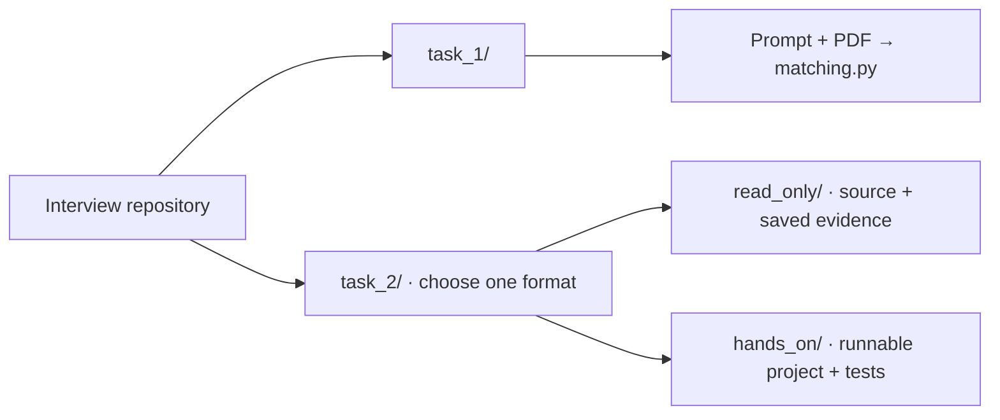

# PhD coding interview

Implement a few-shot classifier, then debug a small PyTorch world model.
**For Task 2, complete only the format assigned by your interviewer.**

| Task | What you do | Time |
| --- | --- | --- |
| [1 · Few-shot classification](task_1/) | Implement `matching_loss`; explain and test it | 35–45 min |
| [2A · Read-only debugging](task_2/read_only/) | Browse code and evidence; propose fixes without running code | 60–75 min |
| [2B · Hands-on debugging](task_2/hands_on/) | Find five bugs, implement fixes and add tests | 90 min |

## Where to start

Open your task's README for the brief and next steps.
[Task 1 PDF](task_1/few-shot-classification.pdf) · [Task 2 formats](task_2/)

Both debugging formats use the same five bugs and measured UBELIX outputs.
The model's loss falls, but its generated trajectories remain poor:

