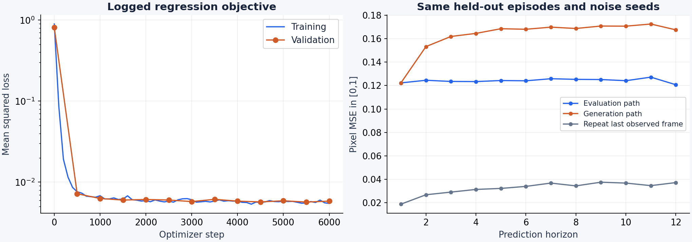
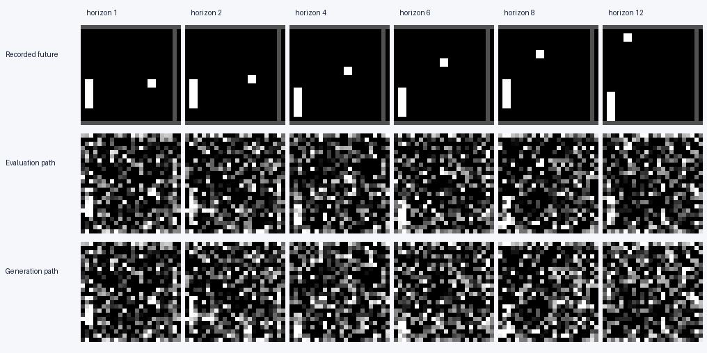
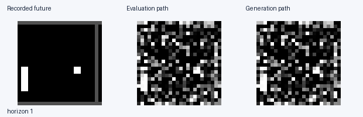
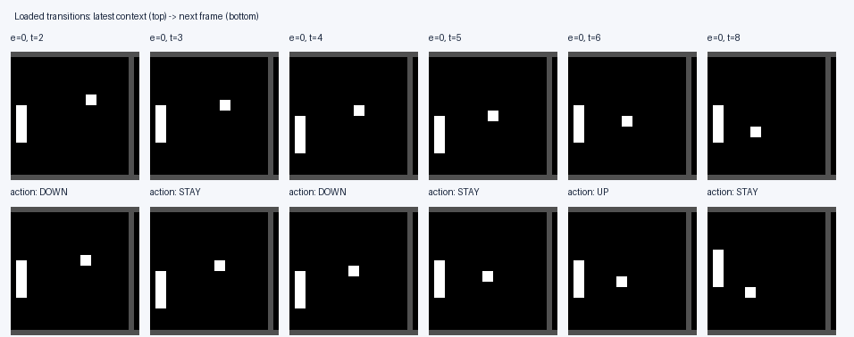

# PhD coding interview

Two candidate exercises in Python and PyTorch: implement a few-shot classifier,
then debug an action-conditioned flow-matching world model.

| Task | Focus | Suggested time |
| --- | --- | --- |
| [Task 1: Few-shot classification](tasks/task1_few_shot.md) | Tensor operations, indexing, numerical stability and algorithmic reasoning | 35-45 minutes |
| [Task 2: World-model debugging](#task-2) | Data, conditioning, training objectives and evaluation | 90 minutes |

## Task 1: Few-shot classification as attention over a support set

Use attention over labelled support embeddings to classify queries. Implement
cosine similarities, temperature scaling, attention over support examples,
aggregation by class, and a differentiable mean negative log-likelihood.

- **[Download the candidate handout (PDF)](output/pdf/task-1-few-shot-classification.pdf)**
- [Read the full prompt](tasks/task1_few_shot.md)
- [Open the Python starter](tasks/task1_matching.py)

Implement `matching_loss` in the starter and add your own behavioural tests.
No training or dataset download is needed. The existing `tests/` suite covers
Task 2's infrastructure; Task 1's starter is deliberately unimplemented.
Use the Python/PyTorch setup instructions under Task 2 below for either task.

The PDF is generated by `python -m scripts.build_task1_pdf` with ReportLab
installed. The prebuilt handout is included; candidates do not need ReportLab.

<a id="task-2"></a>

## Task 2: Debug an action-conditioned world model

**The world model that learned the wrong thing**

**PyTorch · conditional flow matching · suggested time: 90 minutes**

A small action-conditioned world model trains without crashing. Its logged loss
falls, yet generated trajectories are poor and some diagnostics disagree. Your
task is to find the causes, explain their consequences, and propose or implement
minimal fixes with regression tests.

There are **five intentional semantic bugs**, one in each of `dataset.py`,
`dataloader.py`, `model.py`, `trainer.py`, and `eval.py` under `world_model/`.
The environment, sampler and diagnostic scripts are supporting infrastructure.
The public tests are smoke tests, not evidence that the model is correct.

You do not need to retrain the model during the interview. Prioritize small,
falsifiable tests and reasoning about the data and mathematical contracts.

### What the model is supposed to do

Given two observed frames `(o[t-1], o[t])` and an action `a[t]`, predict `o[t+1]`.
At deployment, feed generated frames back as context to imagine a trajectory
under a supplied action sequence. Training and validation should use separate
episodes. A sample's prediction should not depend on unrelated batch members.

The model operates on 24 × 24 grayscale images normalized to `[-1, 1]`.
It predicts a **velocity field**, with a straight interpolation path:

```text
z ~ Normal(0, I),       tau ~ Uniform(0, 1)
x_tau = (1 - tau) z + tau o[t+1]
loss = E[ || v_theta(x_tau, tau, context, action) - d(x_tau)/d(tau) ||² ]
```

Sampling starts with Gaussian noise at `tau=0` and integrates
`dx/dtau = v_theta(...)` to `tau=1` using explicit Euler steps. Here `t` is an
environment step and `tau` is flow time; they are different variables.
Background: [Flow Matching for Generative Modeling](https://arxiv.org/abs/2210.02747).

### Evidence from the supplied run

These plots and images are generated by this repository's code. Their raw numbers,
configuration, data digest, software versions and source digests live in
[`assets/`](assets/). Treat metric names as claims to investigate.

| Observation after 6,000 optimizer steps | Value |
| --- | ---: |
| Final training / validation regression loss | 0.00547 / 0.00583 |
| Distinct train / validation episodes (256 in archive) | 256 / 256 |
| Loaded commands inconsistent with visible paddle motion | 60.4% |
| Max velocity change across different actions, identical context/noise | 0.00000 |
| Max change to one item's velocity when only other items' actions change | 0.08992 |
| Horizon-12 MSE: evaluation / generation path | 0.12072 / 0.16759 |
| Horizon-12 MSE: repeat last observed frame | 0.03711 |

Measured on one UBELIX RTX 4090, training seed 17. The table is an observation
log, not a diagnosis. See [`reports/RUN.md`](reports/RUN.md) for provenance.



The evaluation and generation curves use the **same 32 independently collected
held-out episodes**, actions, initial context, ODE steps and noise seeds. Pixel MSE
is computed on `[0,1]` images; the loss uses normalized tensors. Most pixels are
background, so low pixel MSE alone is not sufficient evidence of useful dynamics.
“Repeat last observed frame” is a no-learning baseline.





The rows show one fixed held-out episode, not a best-of-many sample. The same
episode is used in the animation. The evaluation and generation paths are
separate entry points intended to implement the same open-loop behaviour.



This contact sheet shows six action changes from the beginning of the training
archive. It displays the **action returned by the dataset**. For each column,
compare the latest observed frame with the target frame and consult the action
convention below. The raw archive is available for inspection.

Run statistics are in [`assets/metrics.json`](assets/metrics.json). In particular,
inspect the split counts and the fixed-context action probe. The latter uses
identical image, time and noise inputs while varying actions within a batch;
a second measurement changes only the other batch members' actions.

### Run locally

Python 3.10–3.12 is recommended. A CPU is sufficient for inspection and tests.

```bash
python -m venv .venv
source .venv/bin/activate
python -m pip install -e '.[dev]'
python -m pytest -q
```

For the primary package versions used in the supplied run, install with
`python -m pip install -r requirements-tested.txt -e '.[dev]'`.

The two small dataset archives are bundled. No Atari ROMs, external dataset
downloads, simulator services or API keys are needed.

Optional: download the supplied checkpoint and run records from the
[public release](https://github.com/sebastian-stapf/world-model-debug-interview/releases/tag/v1.0-interview),
then reproduce the observation pack:

```bash
mkdir -p outputs
gh release download v1.0-interview --pattern candidate-run.zip --dir outputs
python -m zipfile -e outputs/candidate-run.zip outputs
python -m scripts.diagnose --checkpoint outputs/candidate/model.pt --output outputs/diagnostics
python -m world_model.eval --checkpoint outputs/candidate/model.pt
```

The release ZIP extracts to `outputs/candidate/`. Saved figures already allow
offline inspection without the checkpoint. Diagnostic generation takes longer
on CPU than the smoke tests; it is optional during the interview.

To regenerate the data or train after making changes:

```bash
python -m scripts.make_data
python -m scripts.make_data --output data/heldout_pong.npz --episodes 32 --seed 90000
python -m world_model.trainer --device cpu --steps 20 --output outputs/smoke
# Full run on a GPU:
python -m world_model.trainer --device cuda --output outputs/run
python -m scripts.diagnose --device cuda --checkpoint outputs/run/model.pt --output outputs/diagnostics
```

Use the CPU command only for a small pipeline check; the published experiment
uses the full configuration in [`configs/default.json`](configs/default.json).

### Data contract

TinyPong is a deterministic Pong-like toy, **not Atari or an ALE benchmark**.
It has a moving ball, a controllable left paddle, and closed court boundaries.
Paddle contact at the left boundary changes the ball's vertical direction.
Episodes have fixed lengths and do not contain resets. Images have no score
overlay or random texture. The collection policy chooses actions independently.

| Array | Shape | Meaning |
| --- | --- | --- |
| `frames` | `[episode, T+1, 1, 24, 24]` | `uint8` observations, including the initial frame |
| `actions` | `[episode, T]` | `int64`; `actions[e,t]` transforms `frames[e,t]` into `frames[e,t+1]` |
| `seed` | scalar | First environment seed; episodes use successive seeds |

| Action | ID | Paddle displacement |
| --- | --- | --- |
| STAY | 0 | 0 pixels |
| UP | 1 | −2 pixels (image row decreases) |
| DOWN | 2 | +2 pixels (image row increases) |

The paddle centre is clipped to rows `[4,19]`. Ball motion is deterministic,
including wall and paddle interactions. The two-frame context supplies velocity
information. The training archive has 256 episodes × 48 transitions (seed 2026);
the independent inspection archive has 32 episodes (seed 90000).

### Repository map

```text
world_model/
  environment.py   Toy physics and rendering
  dataset.py       Transition windows and normalization
  dataloader.py    Splitting and minibatching
  model.py         Conditional U-Net velocity predictor
  trainer.py       Flow objective, optimizer, validation and checkpoints
  sampling.py      Euler integration and deployment generation
  eval.py          Trajectory evaluation
  utils.py         Seeds, configuration and provenance
scripts/
  make_data.py     Deterministic data collection
  diagnose.py      Figures and observational probes
  ubelix.sbatch    Example single-GPU Slurm job
tests/             Public smoke tests; add your own behavioural tests
assets/            Measured diagnostics from the supplied candidate code
```

### Expected interview output

For each issue you investigate, record:

1. Your hypothesis and a minimal experiment that could disprove it.
2. The faulty behaviour and its effect on training or evaluation.
3. A minimal correction and a regression test.
4. Which observed symptoms it explains, and which it cannot explain alone.

Suggested pacing: 10 minutes to inspect the project, 60 minutes to investigate
and implement fixes, 20 minutes to test and discuss. Partial progress supported
by careful experiments is useful. You are not expected to optimize the U-Net,
improve the toy environment or reproduce state-of-the-art Atari performance.

### UBELIX

Create a Python environment on UBELIX, install this project's dependencies, and
submit from the repository root. Adjust the account and GPU type for your own
allocation. Create the log directory before submission:

```bash
mkdir -p outputs
export WM_PYTHON=/absolute/path/to/your/environment/bin/python
sbatch scripts/ubelix.sbatch
```

The script requests one RTX 4090 and runs data collection, training and diagnosis
on the compute node. See the
[UBELIX GPU guide](https://knowit.unibe.ch/en/docs/hpc/runjobs/scheduled-jobs/gpus/)
for current resource syntax. The experiment's actual environment is recorded with
the release; small numerical differences across devices are expected.
