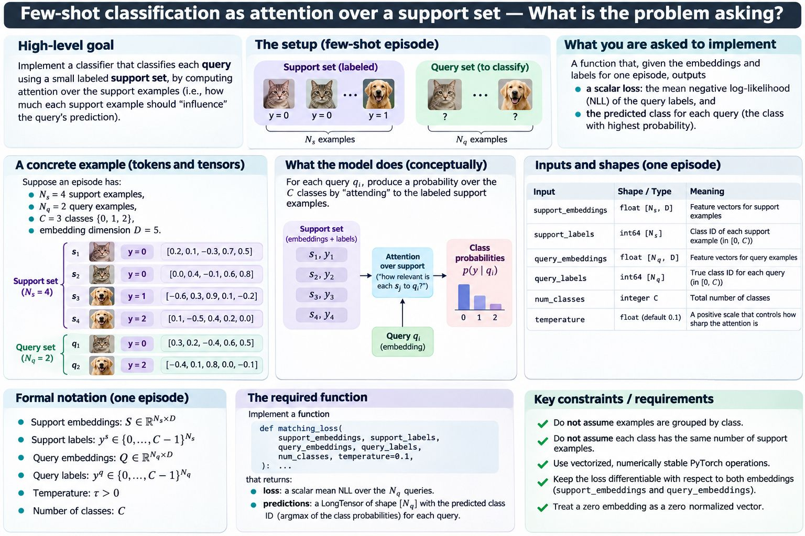

# Task 1 · Few-shot classification

**Python / PyTorch**

Implement [`matching_loss` in `matching.py`](matching.py). For each query,
attend to labelled support examples and return **`(loss, predictions)`**:
a scalar mean negative log-likelihood and a `LongTensor[N_q]` of class predictions.
[Printable prompt (PDF)](few-shot-classification.pdf).

## Inputs

| Argument | Shape / meaning |
| --- | --- |
| `support_embeddings` | Float tensor `[N_s, D]` |
| `support_labels` | Long tensor `[N_s]`; class IDs in `[0, C)` |
| `query_embeddings` | Float tensor `[N_q, D]` |
| `query_labels` | Long tensor `[N_q]`; target class IDs |
| `num_classes` | Integer `C` |
| `temperature` | Positive float; default `0.1` |

## Required computation

1. Compute cosine similarity from each query to every support example.
2. Divide by `temperature`, then softmax **over support examples**.
3. Sum attention weights by support class to obtain class probabilities.
4. Return the mean NLL of the query targets and the highest-probability classes.

Use vectorized, numerically stable PyTorch operations. Keep the loss differentiable
with respect to both embedding tensors. Treat zero embeddings as zero normalized vectors.
Support labels may be unsorted, and class counts may differ.

Assume valid inputs: nonempty sets, positive `D` and `C`, finite embeddings of the
same floating dtype, tensors on the same device, valid `int64` labels, and finite
positive temperature. Every query target appears in the support set; other classes
may be absent and receive zero probability. Input validation is not required.

## Deliverable

Your implementation and a few focused tests. Explain tensor shapes, numerical
choices, and time/space complexity. No training or data download is needed.
Use an existing PyTorch environment or the [Task 2B setup](../task_2/hands_on/README.md#run-locally).
