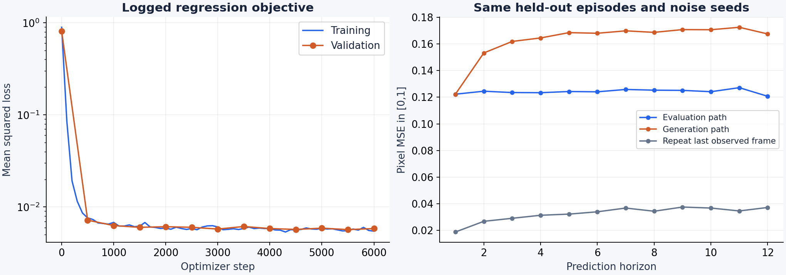
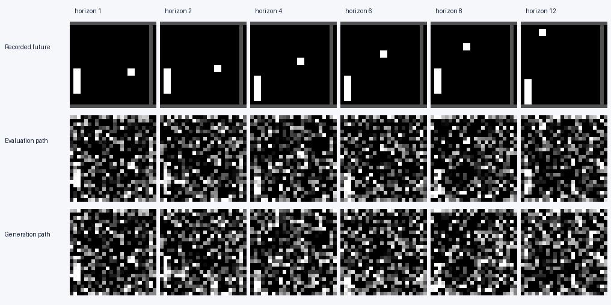
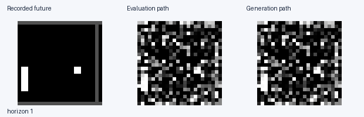
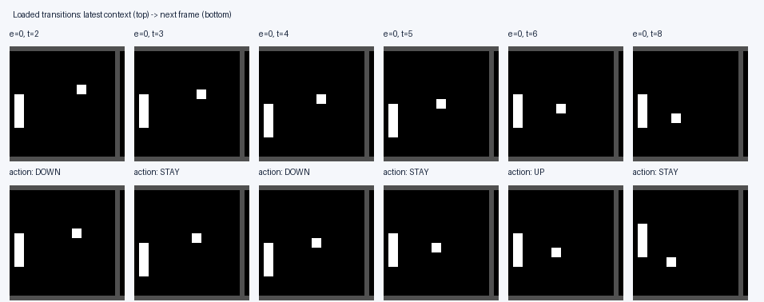

# Recorded evidence

These plots and images are generated by this repository's code. Their raw numbers,
configuration, data digest, software versions and source digests live in
[`assets/`](assets/). Treat metric names as claims to investigate.

| Observation after 6,000 optimizer steps | Value |
| --- | ---: |
| Final training / validation regression loss | 0.00547 / 0.00583 |
| Distinct train / validation episodes (256 in archive) | 256 / 256 |
| Loaded commands inconsistent with visible paddle motion | 60.4% |
| Max velocity change across different actions, identical context/noise | 0.00000 |
| Max change to one item's velocity when only other items' actions change | 0.08992 |
| Horizon-12 MSE: evaluation / generation path | 0.12072 / 0.16759 |
| Horizon-12 MSE: repeat last observed frame | 0.03711 |

Measured on one UBELIX RTX 4090, training seed 17. The table is an observation
log, not a diagnosis. See [`reports/RUN.md`](reports/RUN.md) for provenance.

The evaluation and generation curves use the **same 32 independently collected
held-out episodes**, actions, initial context, ODE steps and noise seeds. Pixel MSE
is computed on `[0,1]` images; the loss uses normalized tensors. Most pixels are
background, so low pixel MSE alone is not sufficient evidence of useful dynamics.
“Repeat last observed frame” is a no-learning baseline.

The rows show one fixed held-out episode, not a best-of-many sample. The same
episode is used in the animation. The evaluation and generation paths are
separate entry points intended to implement the same open-loop behaviour.

This contact sheet shows six action changes from the beginning of the training
archive. It displays the **action returned by the dataset**. For each column,
compare the latest observed frame with the target frame and consult the action
convention below. The raw archive is available for inspection.

Run statistics are in [`assets/metrics.json`](assets/metrics.json). In particular,
inspect the split counts and the fixed-context action probe. The latter uses
identical image, time and noise inputs while varying actions within a batch;
a second measurement changes only the other batch members' actions.

