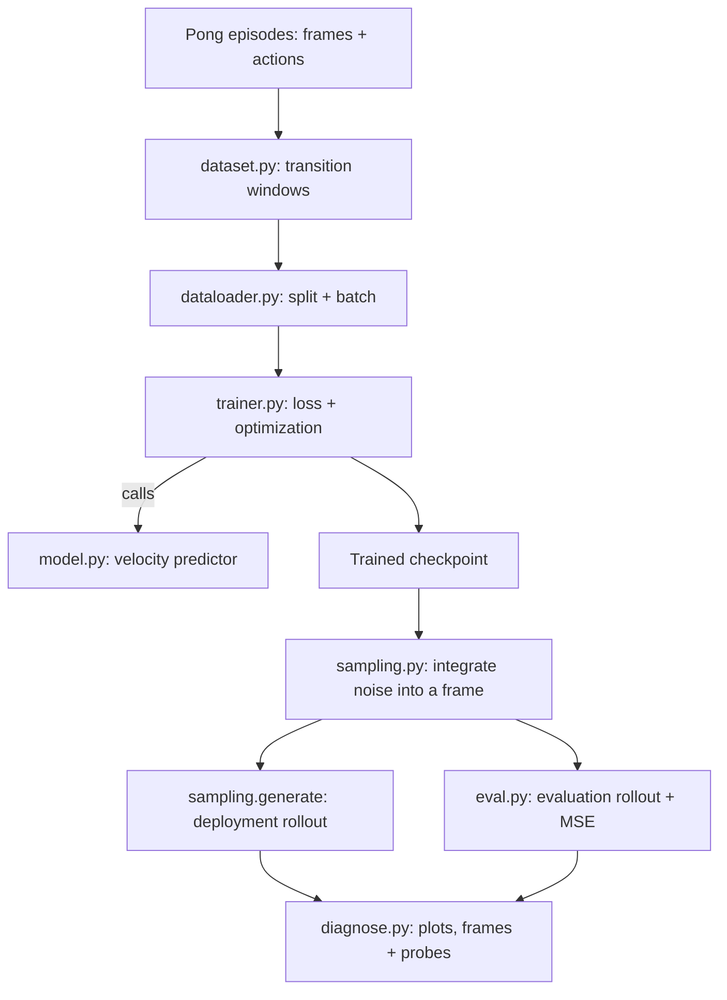
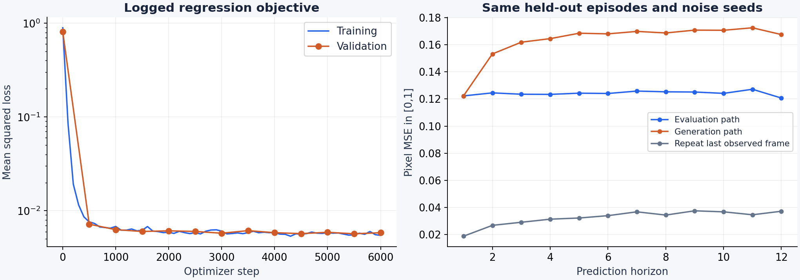
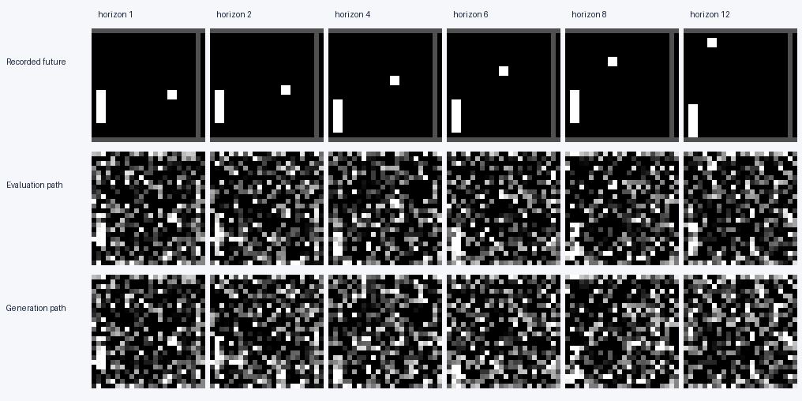

# Task 2B · Hands-on debugging

**Python / PyTorch · Run code, edit and test**

The world model trains without crashing and its loss falls, but its generated
trajectories are poor. Find **five semantic bugs**, one in each file below.
**Explain each cause, implement a minimal fix and add a regression test.**
Retraining is not required; prioritize small checks that test your hypotheses.

## Run locally

Use Python 3.10–3.12. A CPU is sufficient; the small datasets are bundled.
From the repository root:

```bash
cd task_2/hands_on
python -m venv .venv
source .venv/bin/activate
python -m pip install -e '.[dev]'
python -m pytest -q
```

The supplied tests check infrastructure, not the five bugs. Add your own
behavioural tests. Run subsequent commands from `task_2/hands_on/`.

## Start here

1. Read the [model and data contract](SPEC.md) and [recorded evidence](EVIDENCE.md).
2. Trace the five modules, form hypotheses and run targeted checks.
3. Make minimal fixes, test them, and explain which symptoms they address.

| File | Responsibility |
| --- | --- |
| [dataset.py](world_model/dataset.py) | Context, action and target windows |
| [dataloader.py](world_model/dataloader.py) | Train/validation split and batches |
| [model.py](world_model/model.py) | Conditional velocity prediction |
| [trainer.py](world_model/trainer.py) | Training target, loss and optimization |
| [eval.py](world_model/eval.py) | Multi-step evaluation |

## How the project fits together



The model predicts the next frame from two observed frames and an action.
The diagram shows module responsibilities; inspect the implementation to judge
whether it meets the contract. The [environment](world_model/environment.py),
[sampler](world_model/sampling.py) and [diagnostics](scripts/diagnose.py) are
supporting infrastructure. The five bugs are confined to the table's modules.

## Evidence preview





See [EVIDENCE.md](EVIDENCE.md) for measurements, conventions and additional images.
[Optional reproduction commands and UBELIX setup](REPRODUCE.md) are available if needed.

Present the cause, fix and regression test
for each finding, including any remaining uncertainty. Well-supported partial
progress is useful.
