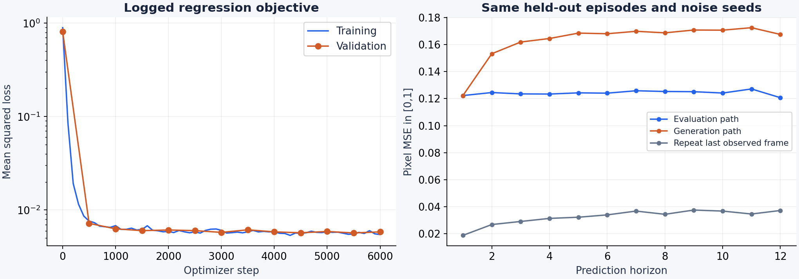
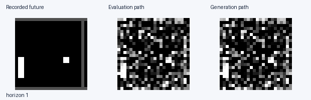
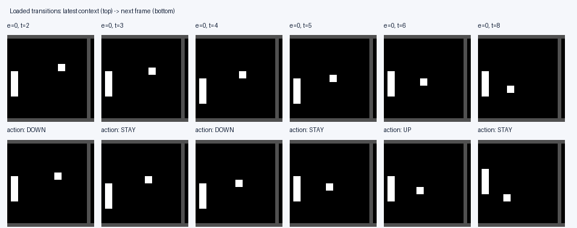

# Task 2A - Read-only world-model debugging

**Independent code review | Suggested time: 60-75 minutes | No code execution**

A small action-conditioned world model trains without crashing. Its logged loss
falls, yet generated trajectories are poor and some diagnostics disagree.
Investigate the implementation and the supplied evidence independently, then
explain the root causes and the changes you would make.

There are **five intentional semantic bugs**, one in each of `dataset.py`,
`dataloader.py`, `model.py`, `trainer.py` and `eval.py`. Choose your own reading
order and investigation strategy. You are not expected to receive step-by-step
guidance from the interviewer.

## How this version works

- Browse the files in this folder using GitHub or a text viewer. Searching
  within files, consulting reference documentation and taking notes are allowed.
- Do not run Python, shell commands, notebooks, tests, debuggers, training,
  evaluation or any other project code. No installation is needed.
- Reason about examples, indices, tensor shapes and information flow on paper
  or in notes. Proposed code edits may be written as text; do not execute them.
- Use the recorded evidence as observations. Clearly distinguish what the code
  proves, what you infer, and what you would check if execution were available.

Everything needed for this version is inside this folder. Source listings end
in `.py.txt` so they can be read as ordinary text. No checkpoint or binary data
archive is needed. The separate hands-on format is not part of this exercise.

## Intended behaviour

Given two observed frames `(o[t-1], o[t])` and an action `a[t]`, predict `o[t+1]`.
At deployment, generated frames become the context for later predictions under
a supplied action sequence. Training and validation should use separate episodes.
A sample's prediction should not depend on unrelated examples in its batch.

Images are 24 x 24 grayscale, normalized to `[-1,1]`. The network predicts a
velocity field along a straight interpolation path:

```text
z ~ Normal(0, I),       tau ~ Uniform(0, 1)
x_tau = (1 - tau) z + tau o[t+1]
loss = E[ || v_theta(x_tau, tau, context, action) - d(x_tau)/d(tau) ||^2 ]
```

Sampling starts from Gaussian noise at `tau=0` and integrates
`dx/dtau = v_theta(...)` to `tau=1` using explicit Euler steps. Environment time
`t` and flow time `tau` are different variables.

| Tensor | Shape |
| --- | --- |
| Context | `[B, 2, 1, 24, 24]` |
| Target / noisy frame / predicted velocity | `[B, 1, 24, 24]` |
| Flow time | `[B]` |
| Action IDs | `[B]` |
| Rollout actions | `[B, horizon]` |
| Recorded future / predicted sequence | `[B, horizon, 1, 24, 24]` |

## Data contract

TinyPong is a deterministic Pong-like toy, not an Atari emulator. It has a ball,
a controllable left paddle and closed court boundaries. Paddle contact at the
left boundary changes the ball's vertical direction. Two consecutive frames
reveal the motion direction. Episodes are fixed length and contain no resets;
the collection policy chooses actions independently.

| Stored array | Shape and interpretation |
| --- | --- |
| `frames` | `uint8 [episode, T+1, 1, 24, 24]`; includes the initial observation |
| `actions` | `int64 [episode, T]`; action at t is issued after observing frame t and produces frame t+1 |
| `seed` | First environment seed; episodes use successive seeds |

| Action | ID | Paddle displacement |
| --- | --- | --- |
| STAY | 0 | 0 pixels |
| UP | 1 | -2 image rows |
| DOWN | 2 | +2 image rows |

The paddle centre is clipped to rows `[4,19]`. The training archive contains 256
episodes of 48 transitions (seed 2026). The independent diagnostic archive has
32 episodes (seed 90000). The raw collector is trusted; loading and batching
training examples are part of the investigation.

The [raw episode excerpt](evidence/episode_excerpt.md) makes some original
observations and action labels readable without opening a NumPy archive.

## Recorded evidence

These are actual outputs from the unmodified candidate project, trained for
6,000 steps on one UBELIX RTX 4090 with seed 17. No candidate rerun is required.

| Observation | Value |
| --- | ---: |
| Final training / validation regression loss | 0.00547 / 0.00583 |
| Distinct train / validation episodes (256 in archive) | 256 / 256 |
| Loaded commands inconsistent with visible paddle motion | 60.4% |
| Max velocity change across different actions, identical context/noise | 0.00000 |
| Max change to one item's velocity when only other items' actions change | 0.08992 |
| Horizon-12 MSE: evaluation / generation path | 0.12072 / 0.16759 |
| Horizon-12 MSE: repeat last observed frame | 0.03711 |



The evaluation and generation curves use the same 32 independently collected
held-out episodes, initial context, actions, batch, ODE steps and noise seeds.
Pixel MSE uses `[0,1]` images; regression loss uses normalized tensors. Most
pixels are background. The persistence baseline repeats the last observed frame.
Metric names are claims to assess, not proof of what an entry point computes.




The displayed trajectory is the first episode in the diagnostic archive. The
evaluation and generation entry points are intended to implement the same
open-loop behaviour. Images are clamped after each frame's ODE integration.



The contact sheet shows six action changes near the start of the training
archive. The top image is the latest context frame; the bottom image is the
target. Captions use the action returned by the dataset.

The action probe holds context, time and noise fixed while varying actions in
one batch. A second probe changes only the other batch members' actions.
Exact measurements are in [metrics.json](evidence/metrics.json), with the
[training history](evidence/history.json), [run configuration](config.json),
[source/data provenance](evidence/provenance.json) and
[training summary](evidence/training_summary.json) alongside them.

## Source files

These are complete, uncorrected source listings from the runnable exercise.
Comments and docstrings express intended behaviour and may disagree with code.

| Module | Listing | Responsibility |
| --- | --- | --- |
| Dataset | [dataset.py](source/world_model/dataset.py.txt) | Construct transition windows |
| Dataloader | [dataloader.py](source/world_model/dataloader.py.txt) | Split and batch examples |
| Model | [model.py](source/world_model/model.py.txt) | Predict the conditional velocity field |
| Trainer | [trainer.py](source/world_model/trainer.py.txt) | Build targets, optimize and validate |
| Evaluation | [eval.py](source/world_model/eval.py.txt) | Evaluate multi-step predictions |
| Sampling | [sampling.py](source/world_model/sampling.py.txt) | Euler integration and deployment generation |
| Environment | [environment.py](source/world_model/environment.py.txt) | Toy dynamics, rendering and raw collection |
| Utilities | [utils.py](source/world_model/utils.py.txt) | Seeds, configuration and checkpoint handling |
| Diagnostics | [diagnose.py](source/scripts/diagnose.py.txt) | Produce the supplied observation pack |
| Data collection entry point | [make_data.py](source/scripts/make_data.py.txt) | Save the raw archives |

The environment, sampler and diagnostic scripts are supporting infrastructure.
The five planted bugs are confined to the first five modules listed above.

## What to hand in or present

For each finding, provide:

1. **Location:** file, function and the relevant expression or line numbers.
2. **Diagnosis:** the intended invariant and how the implementation violates it.
3. **Evidence:** a relevant saved observation, a tensor-shape trace, a small
   worked example or a mathematical derivation.
4. **Correction:** the exact change you would make, written as prose or a short
   unexecuted code snippet.
5. **Verification plan:** a minimal check you would run later, its expected
   result before and after the fix, and any remaining uncertainty.

Explain which symptoms each finding accounts for, how issues interact and what
you would fix first. The [response template](RESPONSE_TEMPLATE.md) is optional.
You do not need to submit a working patch or execute a test in this format.

Suggested pacing: 45-60 minutes of independent browsing and notes, followed by
15 minutes presenting your findings. Clearly justified partial progress is useful.
