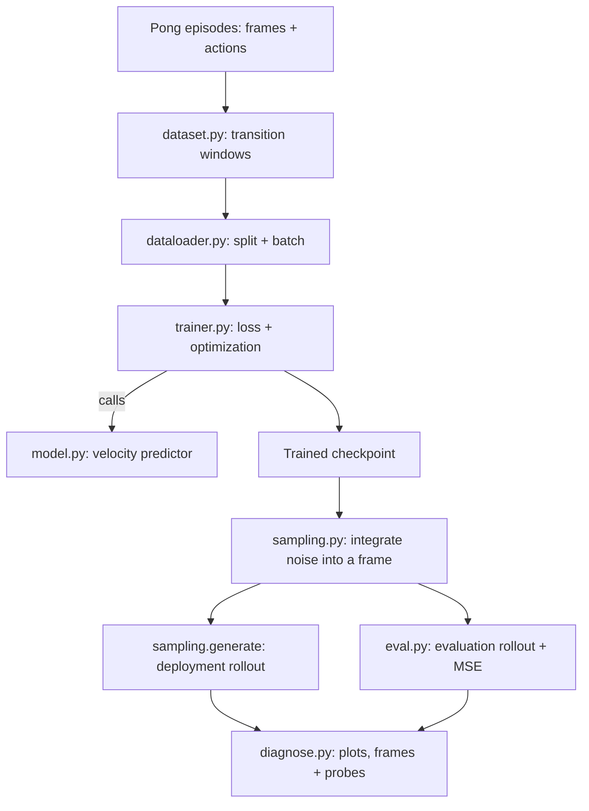
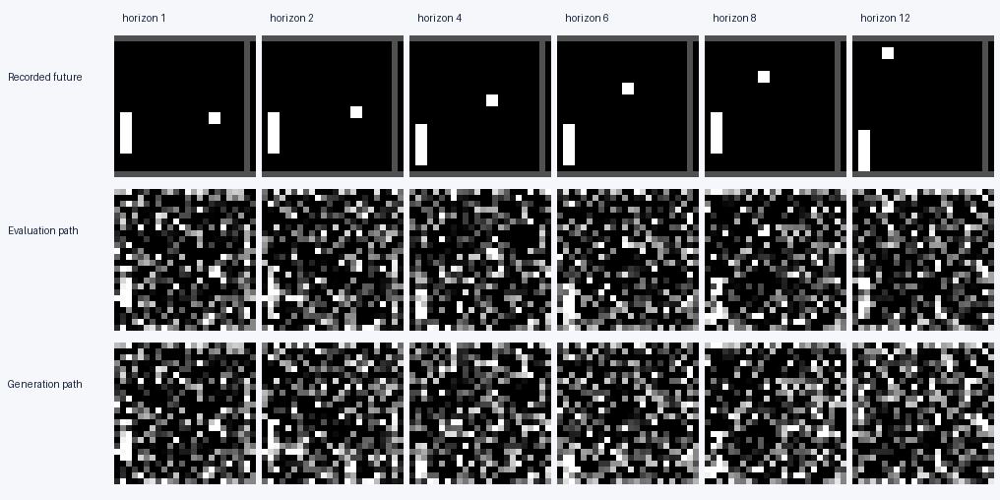

# Task 2A · Read-only debugging

**Independent review · Do not run code**

The world model trains without crashing and its loss falls, but its generated
trajectories are poor. Find **five semantic bugs**, one in each file below.
Browse independently using GitHub or an editor; searching, documentation and notes
are allowed. No installation, terminal commands, tests or program execution.

**Present each bug's location, cause, supporting evidence, proposed fix and a check
you would run to verify it.** Use the optional [response template](RESPONSE_TEMPLATE.md).

## Start here

1. Read the [model and data contract](SPEC.md).
2. Inspect the [saved evidence](EVIDENCE.md) and [raw episode excerpt](evidence/episode_excerpt.md).
3. Trace the source below in any order and connect your findings to the observations.

| File | Responsibility |
| --- | --- |
| [dataset.py](source/world_model/dataset.py) | Context, action and target windows |
| [dataloader.py](source/world_model/dataloader.py) | Train/validation split and batches |
| [model.py](source/world_model/model.py) | Conditional velocity prediction |
| [trainer.py](source/world_model/trainer.py) | Training target, loss and optimization |
| [eval.py](source/world_model/eval.py) | Multi-step evaluation |

## How the project fits together

The model predicts the next frame from two observed frames and an action.
The diagram shows module responsibilities; inspect the implementation to judge
whether it meets the contract. Supporting files:
[sampling](source/world_model/sampling.py), [environment](source/world_model/environment.py),
[utilities](source/world_model/utils.py), [diagnostics](source/scripts/diagnose.py).
The five bugs are confined to the table's modules.

## Evidence preview

All observations, measurement conventions and additional images are in
[EVIDENCE.md](EVIDENCE.md). Everything needed is included in this folder.

Distinguish what the source proves from what you infer. Explain which symptoms
each fix addresses and how you would verify it; a working patch is not required.
